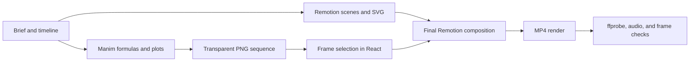

# manim-remotion-explainer-skill

# Manim + Remotion Explainer

A Codex skill for building and rendering code-generated mathematics and science explainer videos with **Remotion**, **React/SVG**, and **Manim**.

The skill includes a working starter project, transparent Manim frame pipeline, procedural audio generation, and MP4 verification tools. It is designed for formula-driven educational videos, waveform and spectrum explainers, and synchronized caption timelines.

## What It Does

- Creates a Remotion project with a synchronized frame-based timeline.
- Renders formulas and mathematical plots with Manim as transparent PNG sequences.
- Selects Manim frames deterministically from the current Remotion frame.
- Generates lightweight background audio without external media services.
- Checks TypeScript, ESLint, stream metadata, frame rate, resolution, and audio level.
- Produces an actual MP4 instead of stopping at a storyboard or code-only project.

It is not intended for live-action editing, talking-head videos, or image-only slide decks.

## Included

| Path | Purpose |
| --- | --- |
| `SKILL.md` | Codex instructions and production rules |
| `agents/openai.yaml` | Skill name, display metadata, and default prompt |
| `assets/project-template/` | Runnable Remotion + Manim starter |
| `scripts/check_environment.ps1` | Checks Node, npm, Python, Pillow, and Manim |
| `scripts/create_project.ps1` | Copies the starter and optionally installs/generates assets |
| `scripts/verify_media.py` | Validates the encoded MP4, audio, and representative frames |
| `references/workflow.md` | End-to-end architecture, render, and QA workflow |
| `references/scientific-animation.md` | Fourier, signal, and ANC accuracy guardrails |

## Requirements

- [Codex](https://codex.openai.com/)
- Node.js `20.19+`, `22.13+`, or `24+`
- Python `3.9+`
- Manim Community Edition `0.22+`
- A working LaTeX installation for `MathTex`
- Pillow for media verification

The included starter currently uses:

- Remotion `4.0.537`
- React `19.2.3`
- TypeScript `5.9.3`

The workflow is tested on Windows. The Python and Remotion project structure is cross-platform, but the provided helper scripts use PowerShell.

## Installation

### 1. Clone the repository into the Codex skills directory

```powershell
git clone <your-repository-url> "$env:USERPROFILE\.codex\skills\manim-remotion-explainer"
```

If `CODEX_HOME` is configured, install under that directory instead:

```powershell
$skills = Join-Path $env:CODEX_HOME "skills"
git clone <your-repository-url> (Join-Path $skills "manim-remotion-explainer")
```

The repository root must contain `SKILL.md` directly:

```text
manim-remotion-explainer/
├── SKILL.md
├── README.md
├── agents/
├── assets/
├── references/
└── scripts/
```

The skill becomes available to Codex on the next turn.

## Usage

Invoke it explicitly:

```text
使用 $manim-remotion-explainer 根据提示词完成一个 9:16 数学科普动画，并实际渲染 MP4。
```

Example requests:

```text
使用 $manim-remotion-explainer 制作一个解释傅里叶变换的视频，公式和波形由 Manim 生成。
```

```text
使用 $manim-remotion-explainer 修改现有 Remotion 工程，重做字幕层级、声波动画和最终渲染验收。
```

Automatic invocation is enabled, so Codex may also select the skill for similar mathematics, science animation, waveform, spectrum, or Manim + Remotion tasks.

## Create a New Video Project

From the installed skill directory:

```powershell
$skill = "$env:USERPROFILE\.codex\skills\manim-remotion-explainer"

pwsh -File "$skill\scripts\check_environment.ps1" `
  -ManimExe "D:\Manim\manim.cmd"
```

Create a starter with dependencies and generated assets:

```powershell
pwsh -File "$skill\scripts\create_project.ps1" `
  -Destination "D:\MyScienceVideo" `
  -ManimExe "D:\Manim\manim.cmd" `
  -Install `
  -GenerateAssets
```

The `-GenerateAssets` option runs:

1. `npm install`
2. `npm run audio`
3. `npm run manim`

Then preview or render:

```powershell
cd "D:\MyScienceVideo"
npm run dev
```

```powershell
cd "D:\MyScienceVideo"
npm run render
```

The starter renders `output/demo.mp4`.

## Starter Workflow



Important implementation rules:

- Drive Remotion motion with `useCurrentFrame()` and `interpolate()`.
- Convert scene timing to exact frame numbers before implementation.
- Use one shared signal definition for time-domain plots and spectra.
- Keep Chinese captions in Remotion instead of generating a second subtitle system in Manim.
- Re-run the Manim script after changing animation length so the frame manifest stays correct.
- Verify the encoded file, not only the React preview.

## Verify a Rendered Video

After installing dependencies, Remotion provides local `ffprobe` and `ffmpeg` binaries:

```powershell
$ffmpegDir = "node_modules\@remotion\compositor-win32-x64-msvc"

python "$skill\scripts\verify_media.py" `
  --video "output\demo.mp4" `
  --ffprobe "$ffmpegDir\ffprobe.exe" `
  --ffmpeg "$ffmpegDir\ffmpeg.exe" `
  --expected-width 1080 `
  --expected-height 1920 `
  --expected-fps 30
```

The verifier reports:

- Width, height, FPS, duration, and codec
- Audio sample rate, channels, RMS, and peak
- Representative extracted frames
- A failure code if an expected property is missing or incorrect

## Repository Layout

```text
.
├── SKILL.md
├── README.md
├── agents/
│   └── openai.yaml
├── references/
│   ├── scientific-animation.md
│   └── workflow.md
├── scripts/
│   ├── check_environment.ps1
│   ├── create_project.ps1
│   └── verify_media.py
└── assets/
    └── project-template/
        ├── package.json
        ├── package-lock.json
        ├── src/
        ├── manim/
        ├── scripts/
        └── public/
```

## Scientific Accuracy

The skill treats scientific claims as part of the implementation, not decorative copy.

- Fourier spectra must be derived from the same sampled signal as the time-domain plot.
- Synthetic signals and spectra must be labeled as synthetic examples.
- Fourier transforms analyze frequency content; they do not remove noise by themselves.
- Active noise cancellation includes microphones, control processing, and speakers, not only a Fourier transform.
- Ideal anti-phase cancellation should be identified as an idealized model.

See `references/scientific-animation.md` for the full guardrails.

## Tested Configuration

The starter was smoke-tested with:

- Node.js `24.20.0`
- npm `11.19.0`
- Python `3.9.12`
- Manim Community `0.22.0`
- Remotion `4.0.537`

A test render completed at:

- Resolution: `1080 × 1920`
- Frame rate: `30 FPS`
- Duration: `8.0 s`
- Video: H.264
- Audio: AAC, 48 kHz stereo

## Troubleshooting

### Manim cannot find LaTeX

Install a working LaTeX distribution and confirm that `latex` is available from the same environment used by Manim.

### `MathTex` fails in a restricted environment

Run the Manim command with normal OS permissions. Some sandboxes block LaTeX subprocesses.

### Remotion fails under a non-ASCII or constrained path

The starter sets `Config.setRspack(false)` in `remotion.config.ts`. Retry the render outside the filesystem sandbox if Chromium or the config compiler is blocked.

### Manim frame paths are missing

Run:

```powershell
$env:MANIM_EXE = "D:\Manim\manim.cmd"
npm run manim
```

Confirm that `src/manimManifest.ts` contains the actual generated frame count.

### npm reports `EPERM` while creating its cache

The npm cache directory is not writable in the current environment. Retry with appropriate permissions or configure npm to use a writable cache directory.

## Publishing

If this folder is not already a Git repository:

```powershell
git init
git add .
git commit -m "Add Manim Remotion explainer skill"
git branch -M main
git remote add origin <your-repository-url>
git push -u origin main
```

Before publishing, add a license file if you intend to permit reuse. This repository currently does not declare a license.
