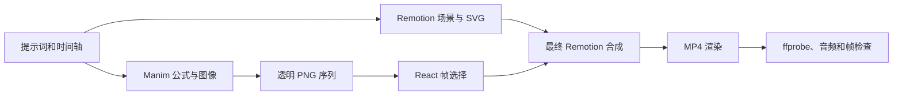

# Manim + Remotion 科普视频

[English](README.md) | **简体中文**

一个用于构建并渲染代码生成数学与科学科普视频的 **Codex 技能**，技术栈包括 **Remotion**、**React/SVG** 和 **Manim**。

技能内置可运行的 Starter 工程、Manim 透明帧生成流程、程序化音频和 MP4 验收工具。适用于公式驱动的教学动画、波形与频谱解释视频，以及需要精确同步字幕时间轴的科普项目。

## 功能

- 创建基于当前帧驱动的 Remotion 视频项目。
- 使用 Manim 渲染公式和数学图像，并输出透明 PNG 序列。
- 根据 Remotion 当前帧确定性地选取 Manim 图像帧。
- 在本地生成轻量背景音频，不依赖外部媒体服务。
- 检查 TypeScript、ESLint、视频流参数、分辨率、帧率和音频音量。
- 实际输出 MP4，而不是停留在分镜、方案或代码片段。

本技能不适用于真人实拍剪辑、口播视频或纯图片幻灯片。

## 包含内容

| 路径 | 作用 |
| --- | --- |
| `SKILL.md` | Codex 使用说明和生产规范 |
| `agents/openai.yaml` | 技能名称、界面信息和默认提示词 |
| `assets/project-template/` | 可运行的 Remotion + Manim Starter |
| `scripts/check_environment.ps1` | 检查 Node、npm、Python、Pillow 和 Manim |
| `scripts/create_project.ps1` | 复制 Starter，可选安装依赖和生成素材 |
| `scripts/verify_media.py` | 验证 MP4、音轨和代表帧 |
| `references/workflow.md` | 完整架构、渲染和 QA 流程 |
| `references/scientific-animation.md` | 傅里叶、信号处理和主动降噪的准确性要求 |

## 环境要求

- [Codex](https://codex.openai.com/)
- Node.js `20.19+`、`22.13+` 或 `24+`
- Python `3.9+`
- Manim Community Edition `0.22+`
- 可用于 `MathTex` 的 LaTeX 环境
- Pillow，用于媒体验收

Starter 当前使用：

- Remotion `4.0.537`
- React `19.2.3`
- TypeScript `5.9.3`

本工作流已在 Windows 环境完成测试。Python 和 Remotion 工程结构可以跨平台使用，但附带的辅助脚本使用 PowerShell。

## 安装

### 1. 克隆到 Codex 技能目录

```powershell
git clone <你的仓库地址> "$env:USERPROFILE\.codex\skills\manim-remotion-explainer"
```

如果配置了 `CODEX_HOME`，可以安装到该目录：

```powershell
$skills = Join-Path $env:CODEX_HOME "skills"
git clone <你的仓库地址> (Join-Path $skills "manim-remotion-explainer")
```

仓库根目录必须直接包含 `SKILL.md`：

```text
manim-remotion-explainer/
├── SKILL.md
├── README.md
├── README.zh-CN.md
├── agents/
├── assets/
├── references/
└── scripts/
```

安装后，技能会在下一轮对话中可用。

## 使用方法

显式调用：

```text
使用 $manim-remotion-explainer 根据提示词完成一个 9:16 数学科普动画，并实际渲染 MP4。
```

其他示例：

```text
使用 $manim-remotion-explainer 制作一个解释傅里叶变换的视频，公式和波形由 Manim 生成。
```

```text
使用 $manim-remotion-explainer 修改现有 Remotion 工程，重做字幕层级、声波动画和最终渲染验收。
```

技能默认开启自动调用，因此 Codex 也可能会在数学、科学动画、波形、频谱或 Manim + Remotion 任务中自动选择它。

## 创建新的视频项目

从已安装的技能目录开始：

```powershell
$skill = "$env:USERPROFILE\.codex\skills\manim-remotion-explainer"

pwsh -File "$skill\scripts\check_environment.ps1" `
  -ManimExe "D:\Manim\manim.cmd"
```

创建包含依赖和生成素材的 Starter：

```powershell
pwsh -File "$skill\scripts\create_project.ps1" `
  -Destination "D:\MyScienceVideo" `
  -ManimExe "D:\Manim\manim.cmd" `
  -Install `
  -GenerateAssets
```

`-GenerateAssets` 会依次执行：

1. `npm install`
2. `npm run audio`
3. `npm run manim`

预览或渲染：

```powershell
cd "D:\MyScienceVideo"
npm run dev
```

```powershell
cd "D:\MyScienceVideo"
npm run render
```

Starter 默认输出到 `output/demo.mp4`。

## Starter 工作流



重要实现规则：

- 使用 `useCurrentFrame()` 和 `interpolate()` 驱动 Remotion 动画。
- 实现前先把场景时间转换成精确帧数。
- 时域图像和频谱必须使用同一份信号定义。
- 中文字幕统一由 Remotion 管理，不在 Manim 中重复制作字幕系统。
- 修改 Manim 动画长度后必须重新运行渲染脚本，保证帧清单正确。
- 验收编码后的视频文件，不能只检查 React 预览。

## 验证渲染结果

安装依赖后，Remotion 会提供本地 `ffprobe` 和 `ffmpeg`：

```powershell
$ffmpegDir = "node_modules\@remotion\compositor-win32-x64-msvc"

python "$skill\scripts\verify_media.py" `
  --video "output\demo.mp4" `
  --ffprobe "$ffmpegDir\ffprobe.exe" `
  --ffmpeg "$ffmpegDir\ffmpeg.exe" `
  --expected-width 1080 `
  --expected-height 1920 `
  --expected-fps 30
```

验收脚本会报告：

- 宽高、帧率、时长和编码格式
- 音频采样率、声道、RMS 和峰值
- 提取的代表帧
- 当预期参数不正确时返回失败状态

## 仓库结构

```text
.
├── SKILL.md
├── README.md
├── README.zh-CN.md
├── agents/
│   └── openai.yaml
├── references/
│   ├── scientific-animation.md
│   └── workflow.md
├── scripts/
│   ├── check_environment.ps1
│   ├── create_project.ps1
│   └── verify_media.py
└── assets/
    └── project-template/
        ├── package.json
        ├── package-lock.json
        ├── src/
        ├── manim/
        ├── scripts/
        └── public/
```

## 科学准确性

技能把科学准确性视为实现要求，而不是装饰性文案。

- 频谱必须根据时域中显示的同一采样信号计算。
- 合成信号和频谱必须标注为示例，不能伪装成真实测量。
- 傅里叶变换用于分析频率成分，并不能自动去除噪声。
- 主动降噪还包括麦克风、控制算法和扬声器，不只是傅里叶变换。
- 同频反相完全抵消属于理想化模型，需要明确说明。

完整规范见 `references/scientific-animation.md`。

## 测试环境

Starter 已完成端到端测试：

- Node.js `24.20.0`
- npm `11.19.0`
- Python `3.9.12`
- Manim Community `0.22.0`
- Remotion `4.0.537`

测试成片参数：

- 分辨率：`1080 × 1920`
- 帧率：`30 FPS`
- 时长：`8.0 秒`
- 视频：H.264
- 音频：AAC，48 kHz 双声道

## 常见问题

### Manim 找不到 LaTeX

安装可用的 LaTeX 发行版，并确认 Manim 使用的工作环境可以调用 `latex`。

### 受限环境中的 `MathTex` 失败

使用正常的系统权限运行 Manim。部分沙箱会阻止 LaTeX 子进程。

### 非 ASCII 或受限路径下 Remotion 失败

Starter 已在 `remotion.config.ts` 中设置 `Config.setRspack(false)`。如果 Chromium 或配置编译器被沙箱阻止，请在沙箱外重试渲染。

### 找不到 Manim 帧

运行：

```powershell
$env:MANIM_EXE = "D:\Manim\manim.cmd"
npm run manim
```

确认 `src/manimManifest.ts` 中记录的是实际生成帧数。

### npm 创建缓存时报 `EPERM`

当前环境的 npm 缓存目录不可写。请使用合适权限重试，或把 npm 缓存配置到可写目录。

## 发布到 GitHub

如果目录还不是 Git 仓库：

```powershell
git init
git add .
git commit -m "Add Manim Remotion explainer skill"
git branch -M main
git remote add origin <你的仓库地址>
git push -u origin main
```

如果需要允许他人复用代码，请在发布前添加 `LICENSE` 文件。本仓库目前尚未声明许可证。
